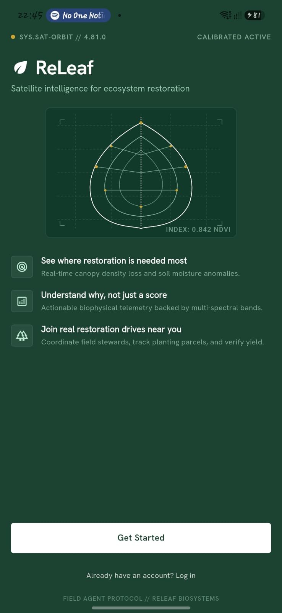
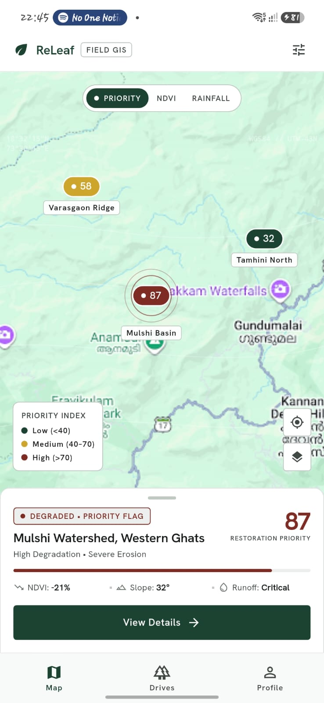
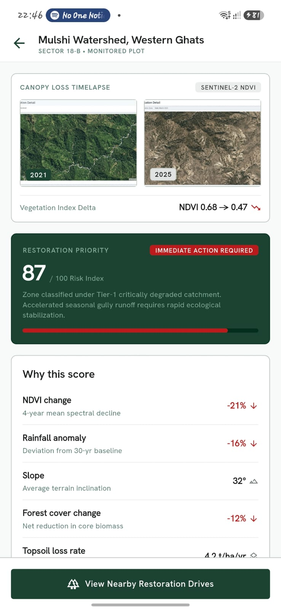
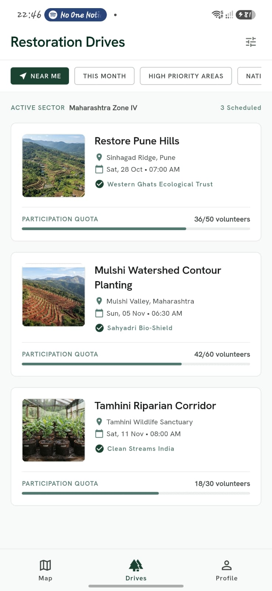
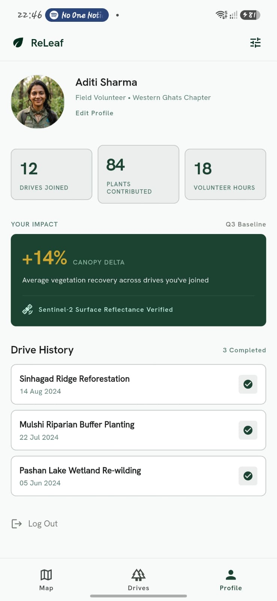

# ReLeaf

**Satellite intelligence for ecosystem restoration**

PCCOE International Grand Challenge 2026 — Round 1 Submission
Theme: AI for Climate Change

---

## ⚠️ Project Status — Round 1 Prototype

This repository is a **work-in-progress prototype**, submitted for Round 1 of the hackathon. It is **not a complete, functioning product**. Please read this section before exploring the code.

- ✅ **Frontend (Flutter app UI):** Partially built. Core screens — onboarding, map view, drive listings, priority-score detail, and profile — exist as UI mockups with static/sample data (see screenshots below).
- ❌ **Backend:** Not implemented yet. There is currently no live satellite data pipeline, no Supabase integration, and no working API. All data shown in the app UI is placeholder/sample data, not real Sentinel-2 or NDVI output.
- ❌ **Data pipeline:** The Python-based NDVI/rainfall scoring pipeline described in the project plan has not been built. Priority scores, "why this score" breakdowns, and recommended actions are illustrative only.

In short: **what you see is a UI prototype of the intended product, not a working end-to-end system.** The full architecture (satellite ingestion → scoring pipeline → Supabase backend → Flutter app) is planned but not yet built — see [Planned Architecture](#planned-architecture) below.

The accompanying presentation (`releaf-ppt-summary` / attached PPT) explains the full intended solution, problem statement, and roadmap for later rounds.

---

## What is ReLeaf?

Restoration NGOs today largely plant trees reactively — wherever land or funding is available, not necessarily where degradation is worst. ReLeaf's goal is to turn publicly available satellite data into a specific, explainable answer: **where restoration matters most, and what kind of intervention it needs** — then connect that directly to volunteers and NGOs who can act on it.

### Core idea
- Detect vegetation/land degradation from satellite imagery (NDVI) for a pilot region
- Score each area by restoration urgency, with the reasoning behind the score shown transparently
- Recommend the right type of intervention (afforestation, erosion control, water conservation, or protection) instead of defaulting to "plant more trees"
- Let NGOs list restoration drives and volunteers join them, with impact tracked over time

## App Preview (Current Frontend)

The current build includes UI screens for:
- **Onboarding** — app intro and value proposition
- **Priority Map** — sector map with color-coded restoration-priority markers
- **Priority Detail** — NDVI before/after comparison, risk score, contributing factors, and recommended action for a selected zone
- **Restoration Drives** — list of NGO-run planting drives with location, date, and volunteer quota
- **Profile** — volunteer stats, impact summary, and drive history

All data in these screens is currently **static/sample data** for demonstration purposes.

| Onboarding | Priority Map |
|---|---|
|  |  |

| Priority Detail | Restoration Drives |
|---|---|
|  |  |

| Profile |
|---|
|  |

> Screenshots live in the [`/screenshots`](screenshots) folder — add the image files there using the filenames above (or update the paths here to match your filenames).

## Planned Architecture

The intended full system (not yet implemented beyond the Flutter UI):

```
Sentinel-2 imagery (Google Earth Engine)
        ↓
Python pipeline: NDVI + rainfall → feature table
        ↓
Scoring + clustering (rule-based score, K-Means)
        ↓
Supabase (Postgres + PostGIS, Auth, Storage)
        ↓
Flutter app  →  Map view · Drive listings · Impact log
```

- **Data pipeline (planned):** Python, pulling Sentinel-2 imagery via Google Earth Engine, computing NDVI and rainfall-based features, and generating a restoration-priority score per area (rule-based scoring + K-Means clustering for grouping similar degradation patterns). Intended to run periodically, not per live request.
- **Backend (planned):** Supabase (Postgres + PostGIS for geospatial data, Auth, Storage), accessed directly by the client — no custom backend API planned.
- **Frontend (in progress):** Flutter app for both NGOs and volunteers — map view, drive listings, and impact log.

## Tech Stack

| Layer | Technology | Status |
|---|---|---|
| Mobile app | Flutter (Dart) | 🟡 In progress |
| Data pipeline | Python + Google Earth Engine | 🔴 Not started |
| Backend / DB | Supabase (Postgres, PostGIS, Auth, Storage) | 🔴 Not started |

## Getting Started (Frontend Only)

```bash
git clone https://github.com/Yato-22/ReLeaf.git
cd ReLeaf
flutter pub get
flutter run
```

Since there is no backend yet, the app currently runs against sample/static data only.

## Roadmap

- [ ] Build the Python NDVI + rainfall scoring pipeline for a pilot region (Pune/Mulshi belt)
- [ ] Set up Supabase schema (Postgres + PostGIS) and connect the Flutter app to live data
- [ ] Wire up real drive-listing and volunteer-matching flow
- [ ] Add repeat-pass comparison to measure actual restoration outcomes over time
- [ ] Expand pilot to additional regions

## Team

Team members, course/year, institute — MMCOE / hackathon team details.

---

*Submitted as a Round 1 prototype for the PCCOE International Grand Challenge 2026. Full problem statement, architecture, and expected outcomes are detailed in the accompanying presentation.*
